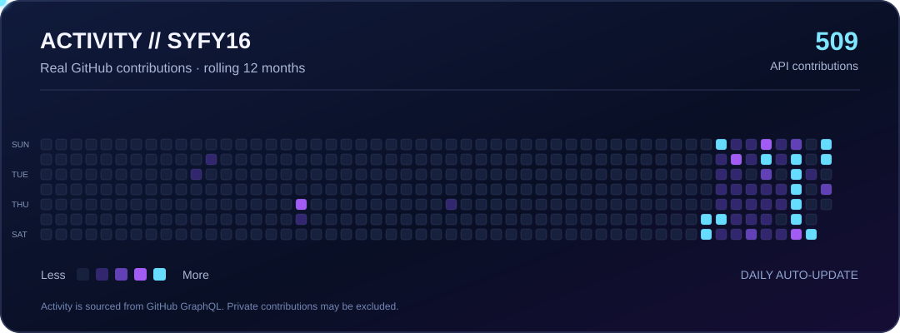

# SYFY16 // WESTSIDE

**GAMING SYSTEMS &nbsp;·&nbsp; CREATIVE CODE &nbsp;·&nbsp; DIGITAL COLLECTIONS**

Building useful tools. Collecting rare things. Designing the experience.

  

---

### // CONTRIBUTION SIGNAL

  

Reale GitHub-Beiträge aus der GraphQL-API · dynamische Neon-Heatmap · animierte SVG-Snake · tägliche Aktualisierung. Die API kann weniger private Beiträge anzeigen als deine persönliche GitHub-Ansicht.

 

### // CONTRIBUTION CITY · 3D VIEW

  

Jedes Gebäude steht für einen aktiven Tag der letzten 90 Tage. Die Höhe folgt der Beitragsanzahl. Darunter: Jahresaktivität.

---

### // ACTIVE PROJECTS

| PROJECT | SYSTEM | FOCUS |
| :--- | :--- | :--- |
| **[PlayStation Radar](https://github.com/westside0106/Ps5-Radar)** | Gaming intelligence | PS Plus · trophies · automated updates |
| **[CollectR](https://github.com/westside0106/Collectorssphere)** | Collection management | Objects · inventory · design |
| **[Vintage Watch Archive](https://uhren.video-showr.de)** | Research archive | Seiko · Citizen · Casio |
| **[Ring Atelier](https://ringe.video-showr.de)** | Creative tools | Jewelry sketching · light & shadow |

**DESIGN × DATA × AUTOMATION**

Profile visuals are generated by GitHub Actions · SVG / Python · no third-party tracking · built for mobile and desktop.

