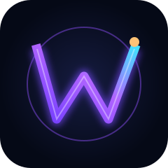
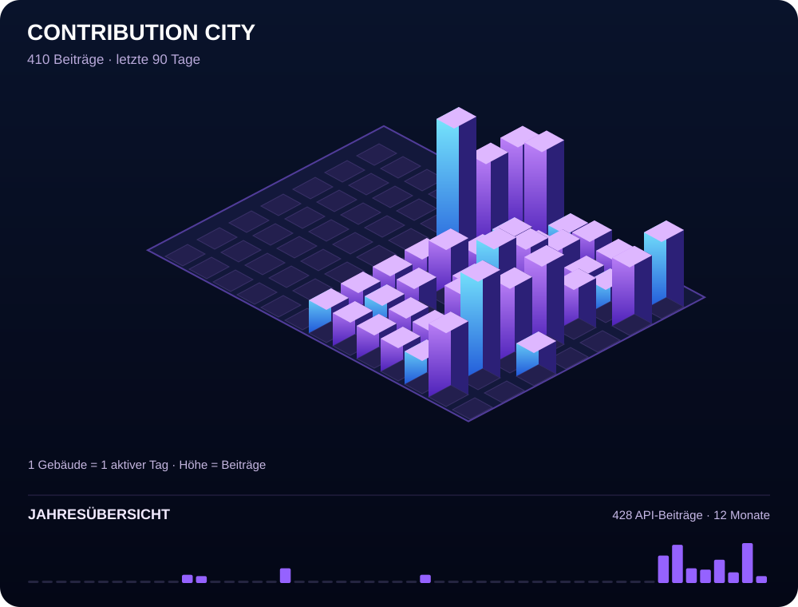

# westside0106

**Gaming · Uhren · Design · Development**

Building tools, collecting things, playing games.

## 🏙️ Contribution City

Jedes Gebäude repräsentiert einen aktiven Tag. Höhe = Beitragsanzahl. Aktualisierung täglich über GitHub Actions. Die API kann weniger Beiträge ausgeben als die GitHub-Profilansicht, etwa bei privaten Beiträgen.

## Selected projects

**[PS5 Radar](https://github.com/westside0106/Ps5-Radar)** — Gaming command center & PlayStation automation

**[Collectorssphere](https://github.com/westside0106/Collectorssphere)** — CollectR collection management

**[Vintage Watch Archive](https://uhren.video-showr.de)** — Catalogs, manuals & calibers

Built with GitHub Actions · Real contribution data · Mobile-friendly

